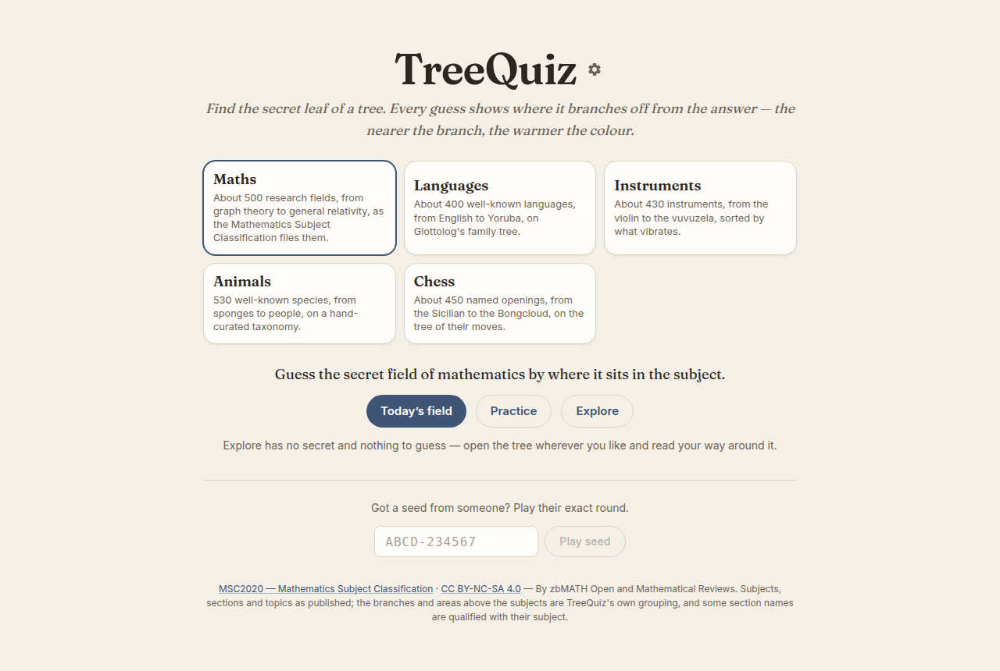
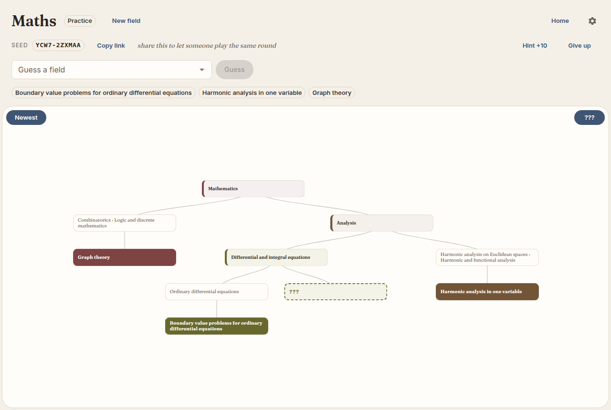
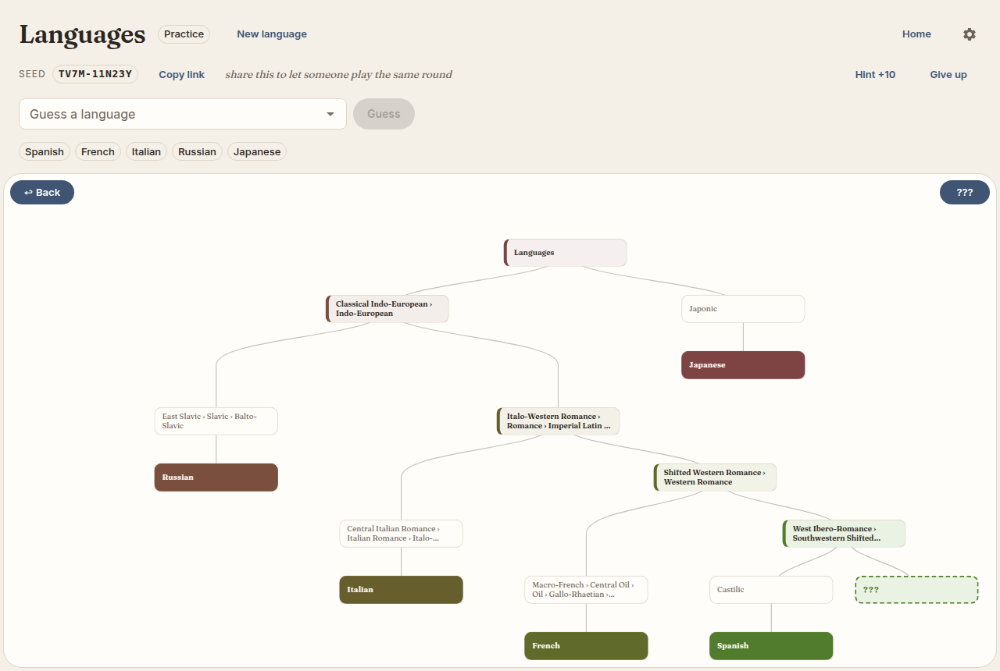
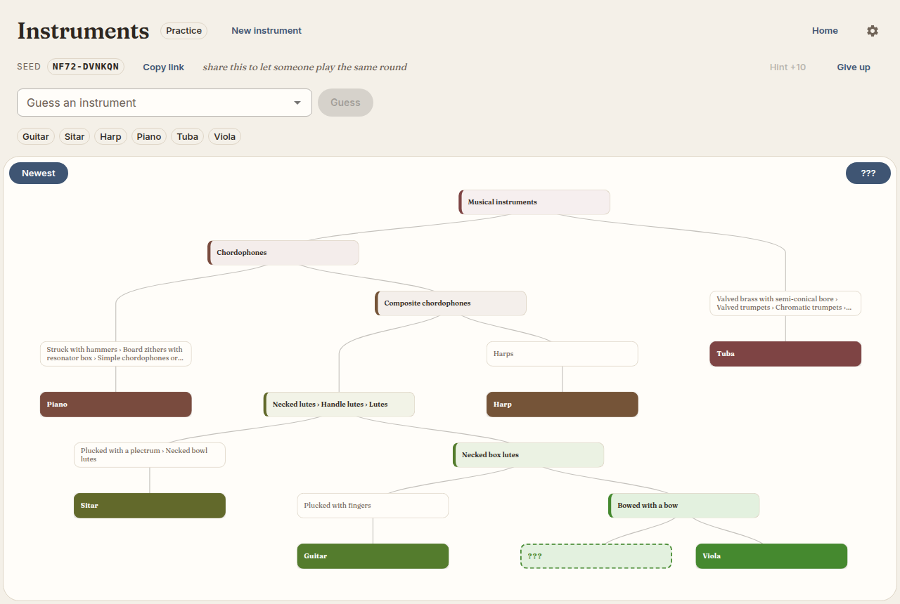
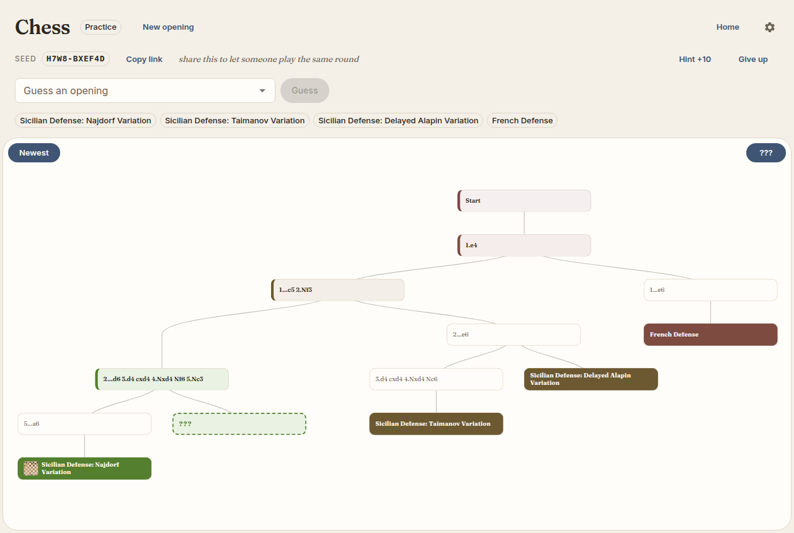
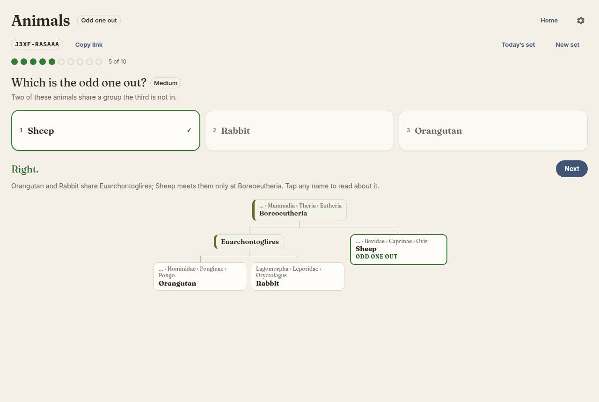

# TreeQuiz

Find the secret leaf of a tree. Every guess shows where it branches off from the
answer, and the nearer that branch point, the warmer the colour.

TreeQuiz is [TaxoQuiz](https://github.com/markharley12/TaxoQuiz) with the
biology taken out. TaxoQuiz's game, explore mode, colour scale, seeds, hints
and phone layout all work on *any* tree. A dataset brings the tree and a short
manifest saying what its leaves are called, and the engine knows nothing else
about it.



## The trees

| Tree | Leaves | Depth | Built from | Ranks |
|---|---:|---:|---|---|
| **Maths** | 517 fields | 5 | [MSC2020](https://msc2020.org), the Mathematics Subject Classification, with a curated branch/area layer above its 63 subjects | ladder: branch → area → subject → section |
| **Languages** | 415 languages | 14 | [Glottolog 5.3](https://glottolog.org)'s family tree, languages chosen by how many Wikipedias cover them | none: placed by the tree's shape alone |
| **Instruments** | 428 instruments | 9 | The [Hornbostel–Sachs](https://en.wikipedia.org/wiki/Hornbostel%E2%80%93Sachs) classification, by what vibrates; instruments and their numbers from [Wikidata](https://www.wikidata.org/wiki/Property:P1762) | none |
| **Animals** | 530 species | 21 | TaxoQuiz's hand-curated taxonomy | the Linnaean ladder |
| **Physics** | 487 topics | 7 | [PhySH](https://physh.org), the American Physical Society's Physics Subject Headings: research areas and physical systems under their disciplines | none |
| **Chemistry** | 465 chemicals | 14 | [ChEBI](https://www.ebi.ac.uk/chebi/)'s classes of chemical structure; elements and compounds chosen on Wikidata by how many Wikipedias cover them | none |
| **Chess** | 446 openings | 11 | [Lichess's opening list](https://github.com/lichess-org/chess-openings), on the tree of the openings' own moves | none |
| **Cities** | 622 cities | 5 | [Wikidata](https://www.wikidata.org)'s cities, countries and regions; continents and subregions from [Natural Earth](https://www.naturalearthdata.com) | ladder: continent → subregion → country |

Each tree was picked to test something different. Maths is shallow with clean
ranks. Languages has no ranks at all, so warmth comes from the tree's shape
alone. Instruments is a classification whose codes *are* the tree: a violin is
321.322-71 and a guitar 321.322-5, so they share 321.322, necked box lutes.
Animals is TaxoQuiz's own data, and its game comes back out unchanged. Chess
is a tree nobody drew: an opening *is* its moves, so two openings share exactly
the moves they agree on. Cities is the one anybody can play, and the
one where a ladder fits best: sharing a country is worth the same in Belgium
as in Brazil.



## How a round works

You guess a leaf. The game draws the guess's lineage and colours it by its
**lowest common ancestor** (LCA) with the secret: share only the root and it is
red, share the secret's immediate group and it is nearly green. A dashed `???`
node shows *which branch* the answer is on, never how deep.

- **Daily** is the same round for everyone today; **Practice** is a random one.
  Every round has a seed (`YCW7-2ZXMAA`) and a share link (`?d=maths&seed=…`).
  A seed's first four characters fingerprint its tree, so a seed pasted on the
  wrong tree is recognised and offered on the right one.
- **Hints** reveal one more node of the answer's lineage, and double your score.
- **Bulk guessing** opens once you have reached a narrow enough group. Type a
  word, and every leaf in that group with that word in its name is guessed at
  once, each one counted.
- **Odd one out** is a second game on the same trees: three leaves, two of
  which share a group the third is not in. A rooted tree decides that
  exactly, so every puzzle has one answer, and the answer is drawn as the
  tree of the three. A set is ten, easy to hard, and has a seed like a round.
- **Explore** has no secret: open the tree anywhere and read it. Every node has
  a popup. For maths that's its MSC topics; for animals and languages it's the
  Wikipedia summary; for chess, the position's board.
- **A finished round can be shared as squares**, one per guess, coloured
  by how close it came (🟥🟧🟨🟩, 🎯 for the answer): how the round went,
  and nothing about where the answer is. Dailies are kept per tree on the
  device, with a streak and a chart of guesses per win, and the front page
  ticks the trees whose daily is done.
- Each tree keeps its own round, so switching tree loses nothing.

## Playing

```bash
cd frontend && npm install && npm run dev      # http://localhost:5173
```

The app needs no server: the engine runs in the browser, and the build is
static files (`npm run build`, then serve `frontend/dist`). The dev server finds
datasets when it starts, so restart it after adding one. In a terminal:

```bash
python3 -m venv .venv && .venv/bin/pip install -e ".[test]"
.venv/bin/treequiz list
.venv/bin/treequiz play languages
.venv/bin/treequiz odd cities
.venv/bin/treequiz explore maths
```

## Adding a tree

This is what the repo is for. A dataset is a directory:

```
datasets/<id>/manifest.json   what the tree is about — written by hand
datasets/<id>/tree.json       the tree — written by a builder or the importer
datasets/<id>/info.json       popup text per node — optional
```

The app finds every directory under `datasets/` at build time, so adding one
needs no frontend change.

**The quick way**: write the tree as an indented outline, or export a
`name,parent` CSV from a spreadsheet, and import it:

```
Programming languages
  Lisp family | Family
    Common Lisp | Language | CL
    Scheme | Language
    Clojure | Language
  ML family | Family
    OCaml | Language
    Standard ML | Language | SML
```

```bash
.venv/bin/python datagen/import_tree.py langs.txt --id proglangs --init
```

`--init` writes a starter manifest to fill in. **The thorough way** is a builder
script that downloads a source and shapes it, like `datagen/build_maths.py`.
See [`datagen/README.md`](datagen/README.md) for both, and for the mistakes
the validator exists to catch.

### The manifest

```json
{
  "title": "Fields of mathematics",
  "short_title": "Maths",
  "prompt": "Guess the secret field of mathematics by where it sits in the subject.",
  "blurb": "About 500 research fields, from graph theory to general relativity…",
  "noun": "field",
  "noun_plural": "fields",
  "ladder": { "levels": { "branch": 1, "area": 2, "subject": 3, "section": 4 }, "top": 4 },
  "bulk_unlock": 0.5,
  "info_source": "MSC2020",
  "long_labels": true,
  "order": 1,
  "sources": [{ "name": "MSC2020", "url": "https://msc2020.org", "licence": "CC BY-NC-SA 4.0" }],
  "checks": { "closer": [{ "to": "05Cxx", "order": ["05Axx", "03Exx", "11Axx"] }] }
}
```

Only `title` is required. `checks.closer` lists relationships nobody disputes,
as orderings: graph theory is closer to enumerative combinatorics than to set
theory, and closer to set theory than to number theory. The validator fails a
tree that breaks one. That is how TaxoQuiz caught a tree that was internally
consistent and still wrong.

### Tree nodes

```json
{ "name": "05Cxx", "label": "Graph theory", "rank": "Section", "aliases": ["05C"] }
```

`name` is unique and is the key; `label` is what's shown and, for a leaf, what's
guessed (default: the name); `aliases` are other things a player might type.
Leaf labels must be unique ignoring case.

## How warmth works

A node's **warmth** is how specific it is, from 0 to 1. A guess scores the
warmth of its LCA with the secret.

- **The root is 0 and every leaf is 1**, whatever their ranks say: everything
  shares the root, and finding the leaf is winning.
- **A ladder places ranked nodes.** In maths, a shared subject is worth ¾
  wherever it sits. A rank is a *claim*: one that contradicts the tree (a
  suborder containing a phylum) is not believed.
- **Everything else is interpolated** between the nearest believed ranks above
  and below, so a chain of unranked groups fans out evenly. Going deeper is
  always strictly warmer.

With no ladder at all, interpolation is all there is: a node sits at the
fraction of the way down the longest lineage beneath it. The languages tree
works this way, and every one of its 23 ordering checks passes, from
English–Scots–Frisian–German down to Arabic–Hebrew–Amharic–Hausa–Swahili.



The answer above is Portuguese. Japanese shares only the root, Russian only
Indo-European, Italian and French narrower groups of Romance, and Spanish its
closest one. Nothing in the languages manifest says how wide a family is; the
colours come from the tree's shape alone.



Instruments work the same way. The answer above is the cello. The tuba is an
aerophone and shares nothing with it. The piano is a chordophone too, but a
zither by Hornbostel–Sachs, so that is all it shares. The harp is a composite chordophone like
the cello, the sitar a necked lute, and the guitar a necked *box* lute like
the cello. The viola is bowed as well, so it shares the cello's closest group.



Chess has no classification at all. A position is a node, named by its line,
and each opening hangs from the position it names, so the tree is the moves
themselves and every branch point is a move where two openings part. The answer
above is the Dragon. The French shares 1.e4 with it; the Taimanov and the
Delayed Alapin share 2.Nf3, then turn off with 2…e6. The Najdorf shares all the
way to 5.Nc3, and only Black's fifth move tells it from the answer. Every
position's popup draws its board.

## Odd one out

The second game asks the tree a different question. Of three leaves, which
two share a group the third is not in? A rooted tree answers that exactly:
either one pair meets below where all three meet, or all three meet at once
and no pair is closer. Puzzles are only ever of the first kind, so each has
one right answer and no judgement goes into it.



Above, the rabbit and the orangutan share Euarchontoglires, and the sheep
joins them only at Boreoeutheria, so the sheep is the odd one out. Most
people guess the orangutan. A set is ten puzzles, getting harder as the
place where all three meet gets more specific. Each answer is drawn as the
tree of the three. Every day has its own set, the same for everyone.

## Layout

```
src/treequiz/   the engine, in Python: the reference implementation, CLI and validator
frontend/       the app: React + MUI + react-d3-tree, with the engine ported to TypeScript
datasets/       one directory per tree; committed
datagen/        builders and the importer; downloads go to datagen/_cache/ (ignored)
tests/          the Python suite, and the generator of the conformance file
```

**The engine runs twice**, in Python and TypeScript. `tests/conformance.py`
writes Python's answers to a fixed set of questions, over every shipped
dataset, into `frontend/src/engine/conformance.json`. Both suites check it, and
compare numbers exactly. Change the Python, regenerate it, then port until
`npm test` passes.

```bash
.venv/bin/python -m pytest -q                  # Python: engine, datasets, builders, CLI
.venv/bin/python tests/conformance.py          # after any engine or dataset change
cd frontend && npm test                        # TypeScript: engine conformance, app, layout
```

## Licences

The code is TreeQuiz's. The data carries its sources' licences, and each
manifest says so; the app shows the attribution on the front page and in every
popup.

- **Maths**: MSC2020 by zbMATH Open and Mathematical Reviews,
  [CC BY-NC-SA 4.0](https://creativecommons.org/licenses/by-nc-sa/4.0/). The
  branches and areas above the subjects are TreeQuiz's own grouping. The
  dataset is redistributed here under the same terms, *non-commercially*.
- **Languages**: Glottolog 5.3, Hammarström, Forkel, Haspelmath & Bank (2026),
  Max Planck Institute for Evolutionary Anthropology,
  [CC BY 4.0](https://creativecommons.org/licenses/by/4.0/),
  doi:[10.5281/zenodo.15525265](https://doi.org/10.5281/zenodo.15525265).
  Choice of languages from [Wikidata](https://www.wikidata.org) (CC0).
- **Instruments**: instruments and their Hornbostel–Sachs numbers from
  [Wikidata](https://www.wikidata.org) (CC0). Three numbers are corrected by
  hand. Class names come from English Wikipedia's *Hornbostel–Sachs* article
  and its four lists by number, after von Hornbostel & Sachs (1914), and are
  shortened where a name only reads under its parent. The electrophone class
  names are TreeQuiz's own, following the 2011 MIMO revision that Wikidata's
  numbers use.
- **Animals**: the taxonomy is TaxoQuiz's hand-curated tree.
- **Physics**: PhySH, the Physics Subject Headings, by the American Physical
  Society, in the public domain (CC0). Where PhySH gives a topic several
  parents TreeQuiz chose one, and topics are chosen by how many Wikipedias
  cover them.
- **Chemistry**: ChEBI, Chemical Entities of Biological Interest (release
  255, EMBL-EBI), [CC BY 4.0](https://creativecommons.org/licenses/by/4.0/):
  the classes and the chemicals' names. Which chemicals, and their ChEBI IDs,
  from [Wikidata](https://www.wikidata.org) (CC0), one corrected by hand.
- **Chess**: the openings, their ECO codes and moves are
  [Lichess's](https://github.com/lichess-org/chess-openings) collection, in
  the public domain (CC0). The boards are drawn by the builder.
- **Cities**: the cities, their countries and first-level regions from
  [Wikidata](https://www.wikidata.org) (CC0), chosen by how many Wikipedias
  cover them; each country's continent and subregion from
  [Natural Earth](https://www.naturalearthdata.com), in the public domain.
- **Popup text** for languages, instruments, animals, physics, chemistry, chess and cities is from English Wikipedia,
  [CC BY-SA 4.0](https://creativecommons.org/licenses/by-sa/4.0/); every entry
  links its article. Images are linked from Wikimedia Commons and carry their
  own licences.
